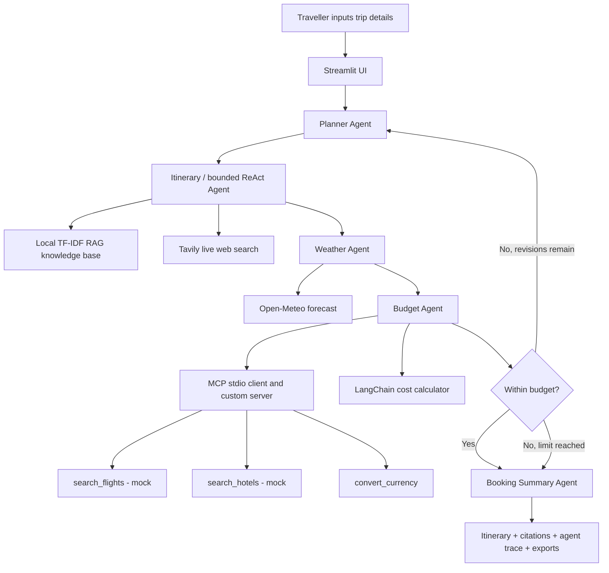
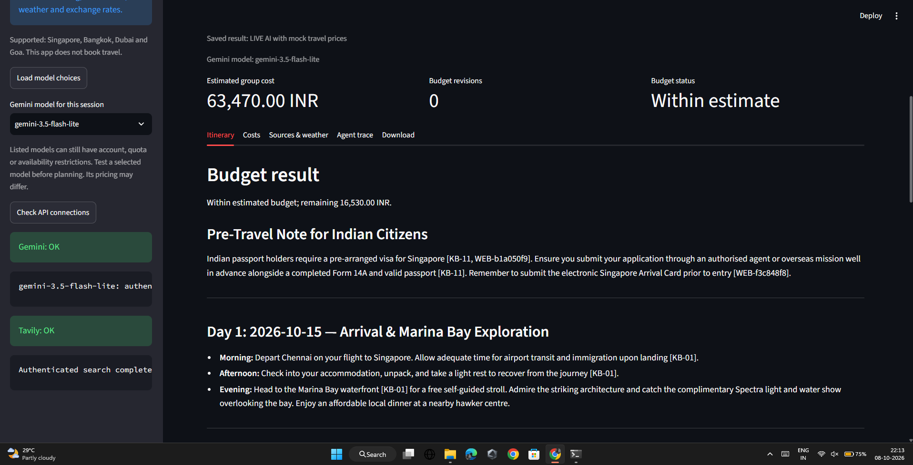
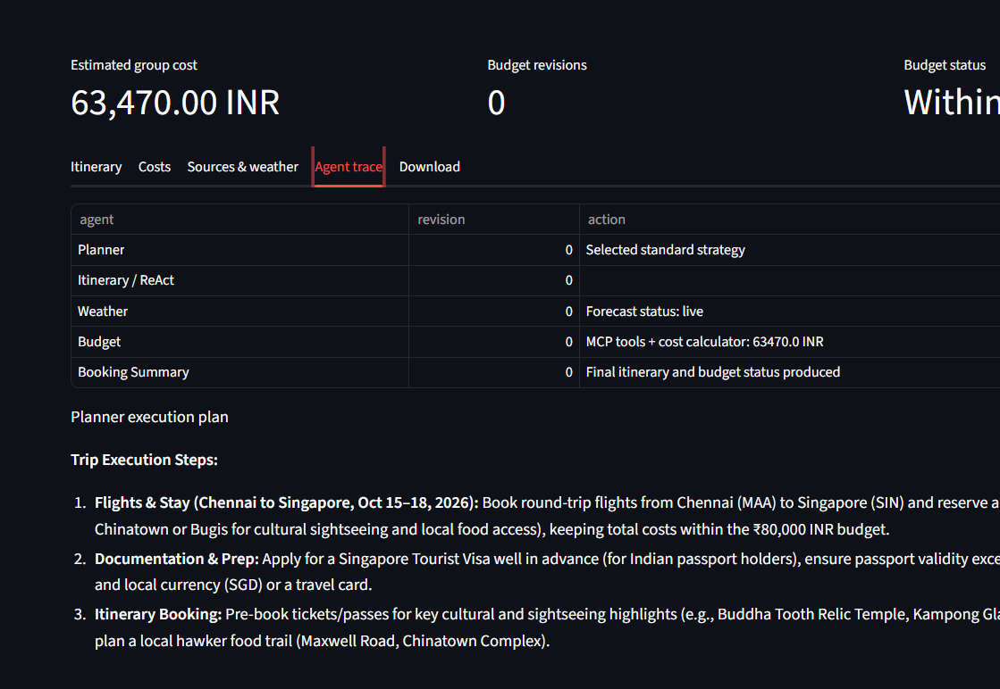
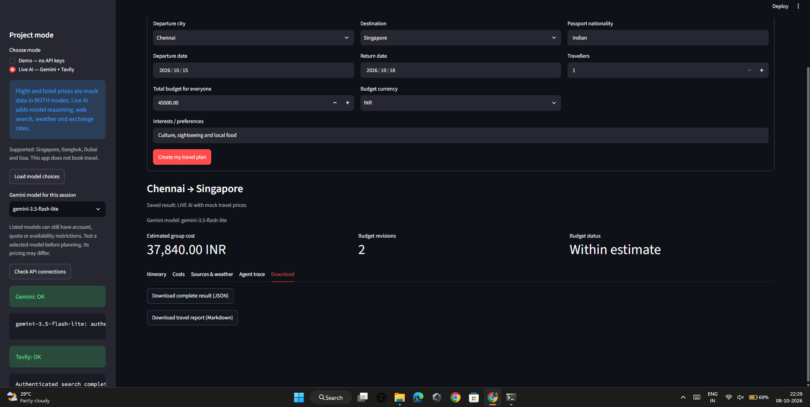
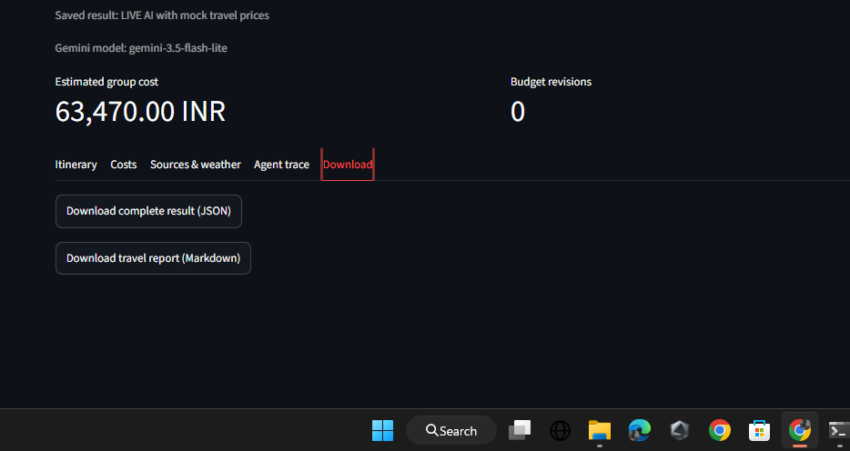

<div align="center">

# 🧭 VoyageAI — Smart Trip Planner
### Agentic AI Travel Planning with Gemini, LangGraph, MCP, RAG & Tavily

**From a travel brief to a sourced, weather-aware and budget-checked day-by-day itinerary.**


**Task 6 | Agentic Systems Capstone | Domain: Travel**

[Features](#-features) · [Architecture](#-system-architecture) · [Screenshots](#-screenshots) · [Quick start](#-quick-start) · [Evaluation](#-evaluation--test-evidence)

</div>

---

## 📌 Executive overview

Planning a trip involves destinations, dates, budgets, accommodation, visa rules, weather and local advisories. **VoyageAI** coordinates five LangGraph agents to produce a practical itinerary with source references, indicative travel costs and weather-driven adjustments. A budget-feedback edge can reroute the trip through cheaper planning strategies. The app supports a local **Demo** mode and an API-backed **Live AI** mode.

> **Important:** Flight and hotel prices are synthetic classroom examples **in both modes**. The app does not make reservations. Verify visa rules with official authorities and confirm actual fares, fees, insurance and availability independently.

### 🎯 Verified results (local run, 8 October 2026)

| Demonstration | Input budget | Estimated trip cost | Outcome |
|:--|--:|--:|:--|
| Chennai → Singapore, 15–18 Oct, one traveller | ₹80,000 | ₹63,470 | Within estimated budget; 0 revisions |
| Same route and dates, lower budget | ₹45,000 | ₹37,840 | Within estimated budget; **2 revisions** |
| Automated tests | — | — | **22 passed, 0 failed**; 1 non-fatal pytest cache permission warning |

These results were observed on the user's Windows system. They are examples, **not reproducible real-world quotes**; API responses and forecasts vary over time.

## ✨ Features

- 🗓️ **Day-by-day itineraries** tuned to trip dates, interests, departure city and destination.
- 🤖 **Five-agent LangGraph workflow** with shared state, Planner → Itinerary/ReAct → Weather → Budget → Booking Summary.
- 🔁 **Budget feedback loop**: standard → economy → minimum strategies with bounded replanning.
- 🧰 **Real custom MCP server (stdio)** with flight search, hotel search and currency conversion tools.
- 📚 **Local RAG** using TF-IDF retrieval over destination, insurance and visa guidance, with citation IDs.
- 🔎 **Tavily web search** for current travel context and advisories in Live AI mode.
- 🌦️ **Open-Meteo** forecasts, with date-specific wet-weather alternatives when available.
- 💱 **Frankfurter** currency reference rates where currency conversion is needed.
- 🧠 **Gemini AI** for planner, itinerary, weather suggestions and summary; model discovery and bounded 503 retries.
- 📤 **JSON and Markdown export** and a visible agent execution trace.

## 🏗️ System architecture



> The diagram is a logical view of the implemented workflow; services are not separate cloud deployments. The app launches the MCP server locally over stdio.

### 🤖 Agent responsibilities

| Agent | Responsibility |
|:--|:--|
| **Planner** | Structures the travel objective and selects standard/economy/minimum strategy. |
| **Itinerary / ReAct** | Retrieves RAG context, uses Tavily, optionally calls bounded LangChain tools, generates daily activities. |
| **Weather** | Obtains forecast where supported and suggests indoor or date-specific changes. |
| **Budget** | Calls the MCP travel tools, calculates totals and triggers conditional replanning when appropriate. |
| **Booking Summary** | Consolidates itinerary, budget result, visa notes, sources and cautionary statements. |

**ReAct guardrail:** at most **5 tool rounds** in the custom action/observation loop. Replanning also has a finite ceiling.

## 🧩 Tools and data sources

| Type | Implemented tools / sources | Data characteristics |
|:--|:--|:--|
| **Custom MCP** | `search_flights`, `search_hotels`, `convert_currency` | Flight/hotel datasets are mock; conversion can use a dated live rate. |
| **LangChain tools** | `retrieve_guides`, `tavily_search`, `get_weather_forecast`, `calculate_trip_cost` | RAG, live research, forecast and cost calculation. |
| **RAG** | `data/knowledge.json`, `trip/rag.py` | Local TF-IDF search, source IDs such as `KB-11`. |
| **Live web research** | Tavily | Search results may include irrelevant pages; cross-check sources. |
| **Weather** | Open-Meteo | Future forecasts only when in the supported forecast horizon. |

## 🖥️ Screenshots

### Live itinerary and budget


### Five-agent execution trace


### Conditional budget replanning (two revisions)


### Export options


## 🚀 Quick start

### Requirements

- Python 3.11+ (Python 3.12 recommended for reproducibility)
- Windows, macOS or Linux; Internet access for Live AI mode
- Gemini and Tavily API keys for **Live AI** (not needed for Demo)

### Windows — one-click start

1. Clone or download this repository and extract it.
2. Double-click **`START_WINDOWS.bat`**.
3. When installation finishes, open **http://localhost:8501** if the browser has not opened.
4. Start with Demo mode or enable Live AI below.

### Manual installation

```bash
python -m venv .venv
```

Windows:

```bat
.venv\Scriptsctivate
python -m pip install -r requirements.txt
python -m streamlit run app.py
```

macOS/Linux: run `source .venv/bin/activate` before the `python -m pip` command.

The MCP server starts automatically. A second terminal is unnecessary.

### 🔐 Enable Live AI

Copy `.env.example` to `.env` and fill it in **locally**:

```dotenv
GOOGLE_API_KEY=YOUR_GEMINI_KEY
TAVILY_API_KEY=YOUR_TAVILY_KEY
GEMINI_MODEL=auto
```

Get keys from [Google AI Studio](https://aistudio.google.com/apikey) and [Tavily](https://app.tavily.com/). Restart the app after editing `.env`, select **Live AI — Gemini + Tavily**, load model choices if required, and click **Check API connections**.

**Never commit `.env`**, credentials, `.venv/`, or private traveller documents to GitHub. `.gitignore` excludes them. Models and free quotas can change; use a listed model verified by the app's connection check.

## 🧪 Evaluation & test evidence

The local Windows validation ran:

```bat
.venv\Scripts\python.exe -m pytest tests -v
```

**Observed outcome: `22 passed, 1 warning in 39.30s`** (8 October 2026). The warning was a Windows/OneDrive pytest cache permission issue, not a failed test. Tests exercise MCP tool transport, retrieval, budget logic, input validation, ReAct iteration limits, model errors and more. Mocked API tests do not by themselves guarantee that a live provider will be available later.

### Sample evaluator prompts / scenarios

| Scenario | Expected behaviour |
|:--|:--|
| Singapore under ₹80,000 | Produces a sourced itinerary, estimated expenses and weather alternatives. |
| Singapore under ₹45,000 | Revises planning strategy when the initial estimated cost exceeds the budget. |
| Impossible low budget | Stops after finite revisions and explains the shortfall rather than promising a fit. |
| Date outside forecast range | Clearly marks forecast unavailable instead of inventing weather. |
| Visa question for Indian passport | Includes local guidance and points to official immigration sources for verification. |
| Provider error | Shows an actionable 404/429/503 error instead of silently fabricating live AI output. |

## 📁 Repository structure

```text
VoyageAI-Smart-Trip-Planner/
├── app.py                   # Streamlit interface
├── mcp_server.py            # Custom FastMCP server (3 tools)
├── trip/
│   ├── agents.py            # LangGraph orchestration + bounded ReAct
│   ├── mcp_client.py        # MCP stdio client
│   ├── rag.py               # Local retrieval with citations
│   ├── providers.py         # Gemini/model discovery and provider handling
│   ├── tools.py             # LangChain tools and live APIs
│   └── core.py              # Input checks and pricing logic
├── data/
│   ├── catalog.json         # Synthetic flights and hotels
│   └── knowledge.json       # Local cited travel guidance
├── tests/                   # Pytest tests
├── docs/                    # Project report, validation and examples
├── assets/                  # Screenshots for this README
├── requirements.txt
├── requirements-lock.txt
├── .env.example             # Safe template only
├── .gitignore
└── START_WINDOWS.bat
```

## ⚠️ Limitations & responsible use

- Mock flight/hotel costs and accommodations are **not reservable**. No trip has been booked.
- **Singapore immigration rules must be checked on the [official ICA website](https://www.ica.gov.sg/)** before travel; admission and visa approval are not guaranteed.
- Weather forecasts and web results are time-sensitive, may be incomplete, and should be rechecked.
- Visa fees, insurance, baggage and some other trip costs are not quoted individually.
- The UI is a structured form, not an open-ended conversation, and currently offers JSON/Markdown rather than PDF export.
- Supported origins, destinations and currencies are intentionally limited for this capstone.

## 📖 Documentation

- [Project report](docs/PROJECT_REPORT.md)
- [Validation guide](docs/VALIDATION.md)
- [Example output](docs/EXAMPLE_OUTPUT.md)

## 🔮 Possible future extensions

Real provider integrations for bookable travel pricing, an interactive route map, PDF export, richer destination knowledge bases, a chat-based itinerary editor and automated source-quality filters.

---

<div align="center">

**Built as an Agentic Systems capstone demonstration — designed for reproducibility, source transparency and bounded multi-agent execution.**

</div>
