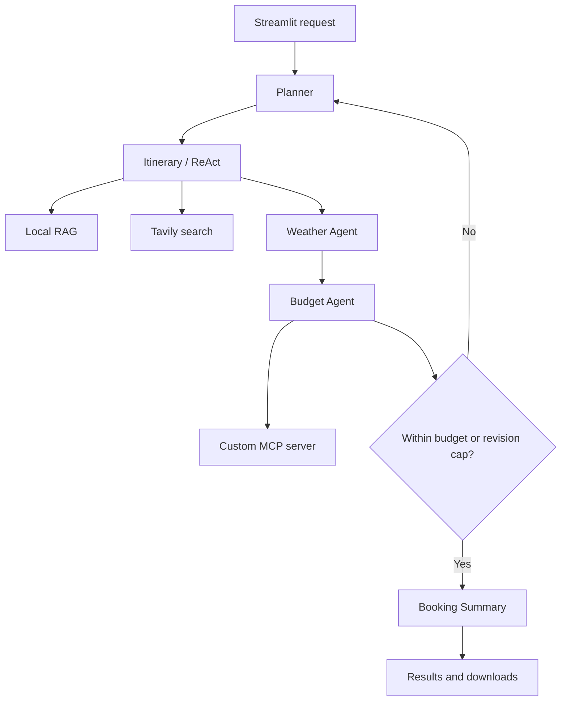

# Smart Trip Planner Using Multi-Agent AI, MCP, RAG and LangGraph

## Abstract

This project converts a structured travel request into a day-by-day itinerary and a transparent cost estimate.
It coordinates five agent roles using LangGraph, exposes mock travel inventory and currency conversion through a
custom MCP server, retrieves local knowledge with citations, and uses Tavily for current travel research.
An explicit bounded ReAct loop lets the itinerary agent call tools and use their observations. A deterministic
budget checker can return control to the planner for at most two revisions. The Streamlit interface shows
sources, workflow actions, selected mock options and downloadable results. An offline-after-installation demo
mode supports teaching and testing without API credits, while Live AI mode activates Gemini and external APIs.

## Problem and objective

Travellers often consult separate sites for accommodation, transport, weather and destination guidance.
The project brings these inputs into one explainable planning workflow. Its objective is to demonstrate
agent coordination and auditable decision support, not to sell tickets or guarantee real travel costs.

Target users: students, leisure travellers and small travel agencies evaluating itinerary ideas.

## Mandatory requirement mapping

| Requirement | Implementation | Demonstration evidence |
|---|---|---|
| Custom MCP server, at least 3 tools | `mcp_server.py`: search_flights, search_hotels, convert_currency | Actual stdio client calls; inspect selected options and FX metadata |
| At least 2 additional LangChain tools | `trip/tools.py`: calculate_trip_cost and get_weather_forecast | Budget and Weather nodes invoke decorated tools |
| RAG with citations | `trip/rag.py`, knowledge JSON, context supplied to itinerary agent | Sources tab with stable KB IDs; report citations |
| Tavily web search | `tavily_search` called for each new live request and available in ReAct | Sources tab shows results or an explicit failure |
| ReAct agent with iteration cap | `react_itinerary` model/action/observation loop | Trace shows tools, capped at 5 rounds plus final tool-free response |
| 3+ agents in LangGraph | Planner, Itinerary, Weather, Budget, Booking Summary | Agent trace and graph source |
| Shared state | `TripState` TypedDict | Request, evidence, forecasts, costs and revision state |
| Conditional routing | Budget → Planner when over budget and revision < 2 | 50,000 and 1,000 INR demonstration cases |

The Budget role is deterministic/tool-driven; Planner, Itinerary, Weather and Summary use Gemini in Live AI mode.
In demo mode all five roles are deterministic. Demo alone does not demonstrate live AI compliance.

## Architecture

All five agent nodes share one state object. Tools add evidence and calculated values to the workflow;
model-generated text cannot replace the deterministic budget total.

## Data design

`catalog.json` contains 32 mock round-trip flight records (four origins × four destinations × two options)
and 12 hotel records (four destinations × three tiers). All prices are synthetic INR examples and do not
vary by date. Dates are passed through the MCP interface to make the search contract explicit.

`knowledge.json` contains nine starter documents: four destination guides, four visa verification checklists
and one insurance/cost checklist. Each document has a citation ID, title, kind, reference URL and text.
Destination documents also provide an ordered places list for deterministic demo output.
The Singapore visa entry is a dated paraphrase of the official ICA India guidance reviewed on 2026-09-27.
Other entries are editorial planning/checklist notes. Expand and refresh them with official documents before making additional visa-policy claims.

## Retrieval and generation

1. Convert document text to TF-IDF vectors with unigrams and bigrams.
2. Vectorize the destination/nationality/topic query.
3. Rank with cosine similarity and retrieve up to five nonzero matches.
4. Provide evidence and citation IDs to the Itinerary Agent.
5. Generate the itinerary, preserve retrieved sources and display citation metadata.

TF-IDF is used instead of embedding APIs/Chroma to keep installation practical and API costs lower.
This is an intentional implementation change from the initial suggested stack; vector-database storage
is not mandatory in the supplied rubric. A future extension could use semantic embeddings and Chroma.

## ReAct loop

The live itinerary model receives the trip context and tool schemas. It can choose a tool, receive an observation,
and continue planning. Up to four tool calls are executed per round and up to five tool rounds are permitted.
At the cap, the application asks for a final answer without tools. Tool errors become unavailable observations.
The UI records public action summaries, not private model reasoning. Loop behaviour is tested using a mock model.

## Budget arithmetic and replanning

- Return flight cost = per-person fare × travellers.
- Hotel cost = nightly rate × nights × ceiling(travellers / 2).
- Food, local transport and activity allowances = daily allowance × days × travellers.
- Contingency = 10% of subtotal.
- Total in requested currency = INR total × reported conversion rate.

Initial strategy uses standard hotels; first revision chooses economy; second chooses budget accommodation.
Daily allowances also decrease. Dates, traveller count and budget are never silently changed.
If the third evaluated plan remains too expensive, the final output explicitly reports the shortfall.

Visa fees, insurance premiums and baggage supplements are not separately priced; the estimate must not
be represented as a complete vendor quote. The cost table clearly labels all allowances and exclusions.

## Guardrails

- Required date and budget fields; validation rejects invalid dates, amounts and unsupported routes.
- Passport nationality collected; no passport number collected.
- No guessed visa approval or exemption. Official sources must be checked.
- No weather assumptions for dates outside the API forecast window.
- Mock fares and hotels labelled in both modes.
- Failed live currency conversion stops calculation; no fake live-rate fallback.
- Tavily/weather failures visible in evidence instead of silently fabricated results.
- API secrets loaded from ignored `.env`; never included in exports.
- Retrieved documents treated as untrusted data in system instructions. This reduces but does not eliminate
  prompt-injection risk; no arbitrary code execution or booking/payment tools are available to the model.
- Bounded tools, network timeouts, graph recursion limit and two-revision budget cap.

## Evaluation procedure

Run `python -m pytest -q` to check input validation, group/room arithmetic, local retrieval, unavailable forecasts,
actual MCP protocol communication, affordable plans, successful replanning, impossible budgets, currency,
same-day travel and ReAct limits. Inspect the accompanying validation notes for what was actually run.

For a live viva, set keys locally and verify: Tavily response status is live; citations correspond to retrieved
sources; model output contains one entry per travel day; weather source matches dates; MCP costs match the table;
and lower budgets trigger conditional routing. Keep any provider error visible and describe it honestly.

## Limitations and future work

- No actual airline/hotel booking, payments, live inventory or availability checks.
- Four destinations and four origins; sample hotel tiers are classroom estimates.
- No stored user accounts, persistent chat history or production authentication.
- Local starter corpus needs expansion and date-verification for detailed visa policies.
- LLM output/citations can still be incorrect; source entailment and itinerary feasibility need review.
- Public API availability, quotas, provider terms and model IDs may change.
- Optional future additions: maps, reviewed PDF ingestion, semantic retrieval, live inventory, PDF export
  and conversational itinerary edits.

## Simple viva answers

**What does your project do?** It creates a travel plan and checks its estimated cost against the user's budget.

**Why use multiple agents?** Each role has a clear task: plan, build an itinerary, check weather, calculate cost or summarize.

**What is MCP?** It is a standard way for the application to discover and call external tools. Here it connects to our travel server.

**What is RAG?** It retrieves relevant documents before the AI writes an answer, so the answer can use traceable evidence.

**Why use Tavily?** It retrieves current web information such as closures and events that the local documents may not contain.

**What is ReAct?** The agent alternates between choosing a tool and reading its result before finishing the answer.

**What is conditional routing?** The next workflow step depends on a condition. An over-budget trip goes back to the Planner.

**How do you stop endless loops?** The ReAct agent has five tool rounds, and budget replanning has two revisions.

**Are the prices real?** No. Flight and hotel prices are labelled mock records. Live mode uses actual external search,
weather and reference currency services, but it does not turn the inventory into real booking quotes.

**Why is demo mode useful?** It lets us test the interface, MCP tools, budget calculations and graph without spending API credits.
